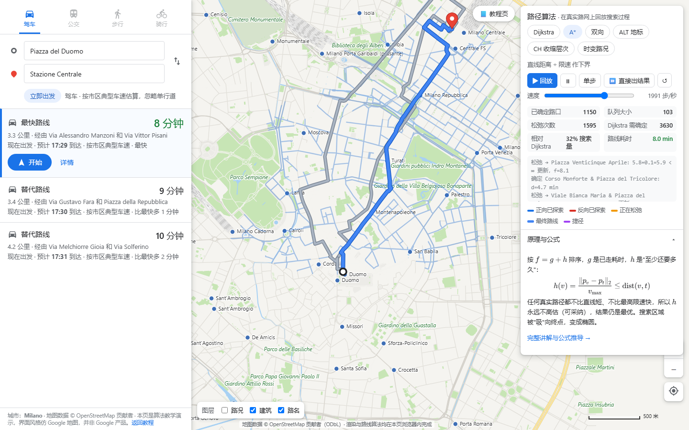
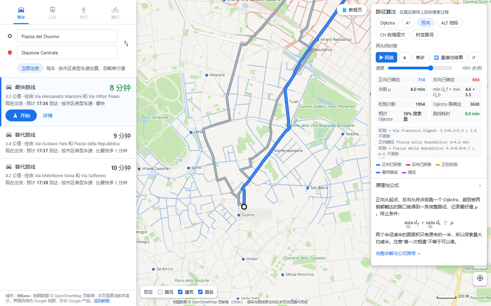

# Map Routing Visualizer · 地图导航算法可视化

**How does a map app actually compute your route?** This project answers it visually: six route-planning
algorithms — Dijkstra, A*, bidirectional search, ALT (landmarks), Contraction Hierarchies and
time-dependent routing — replayed step by step on the **real road network of central Milan**
(OpenStreetMap), inside a Google-Maps-style interface, plus an eight-chapter tutorial with the
math behind each step. Pure front-end, no build step, works offline.

**地图软件是怎么算出路线的？** 本项目把 Dijkstra、A*、双向搜索、ALT 地标、收缩层次（CH）和时变路况
六种算法的搜索过程，逐步回放在**米兰市中心的真实路网**上（OpenStreetMap 数据），界面仿 Google 地图；
另配一个八节教程页，每一步都有公式、伪代码和可单步的动画。纯前端、无需构建、离线可用。

🔗 **Live demo / 在线演示：** https://zcube7.github.io/map-routing-visualizer/map.html ·
📘 **Tutorial / 教程页：** https://zcube7.github.io/map-routing-visualizer/






## What you can do / 能做什么

| | |
|---|---|
| **Pick origin & destination** | Right-click the map ("从此处出发 / 前往此处"), or type a street name (e.g. `Corso Buenos Aires`) with autocomplete. |
| **Watch the search** | Blue = forward frontier, red = backward, purple dashed = CH shortcuts, yellow = node being settled. Play / pause / step / skip, speed up to ~20k events per second. |
| **Read the route like a map app** | Fastest route + alternatives, "via …" roads, turn-by-turn steps, ETA; press **开始** to simulate driving with a follow camera. |
| **Compare algorithms** | Nodes settled, relaxations, % of Dijkstra's search, μ for bidirectional, shortcut unpacking for CH; the key formula of each algorithm is rendered with KaTeX. |
| **Traffic by time of day** | Time-dependent mode colours every road by its speed at the chosen departure time and reroutes around rush-hour congestion. |

Measured on the default query (Piazza del Duomo → Stazione Centrale, all six algorithms agree on 8.0 min):

| Algorithm | Nodes settled | vs Dijkstra |
|---|---|---|
| Dijkstra | 3 630 | 100 % |
| A* (straight-line / max speed) | 1 150 | 32 % |
| Bidirectional Dijkstra | 1 408 | 39 % |
| ALT (8 landmarks) | 394 | 11 % |
| Contraction Hierarchies (0.7 s preprocessing, 7 841 shortcuts) | 108 | 3 % |

## Run it / 运行

Double-click `map.html` (map mode) or `index.html` (tutorial). No server, no network, no install.

Or serve the folder:

```bash
python -m http.server 8765      # then open http://localhost:8765/map.html
```

Self-check (five algorithms must agree on 120 random queries across three random networks; CH
unpacked path cost must equal μ; heuristics must be consistent; time-dependent weights must be FIFO):

```bash
npm test        # = node test/check.js
```

URL parameters for map mode: `?algo=astar|bidir|alt|ch|td&instant=1&zoom=1.8&hour=18`.

## Tutorial chapters / 教程章节

| 节 | 主题 | 演示 |
|---|---|---|
| 0 | 导读 | 导航系统流水线、各算法查询耗时量级 |
| 1 | 道路网 → 带权图 | 悬停看路段长度/限速/耗时；Haversine 距离计算器；重新生成路网 |
| 2 | Dijkstra | 泛洪动画、优先队列前 5 项、逐步松弛日志 |
| 3 | A* | f = g + εh，ε 滑块（0 = Dijkstra，>1 加权 A*），h(v) 热力图，相对最优检查 |
| 4 | 双向 Dijkstra | 两侧搜索、μ 的更新、终止条件 min Q_f + min Q_b ≥ μ 的实时判定 |
| 5 | ALT | 最远点法选地标（1～8 个）、三角不等式下界、与欧氏下界的紧度对比 |
| 6 | 收缩层次 CH | 8 节点玩具图逐帧讲解（见证搜索 / 捷径 / rank / 只向上的双向查询 / 捷径展开）+ 整张路网的预处理与查询动画 |
| 7 | 实时路况 | 时变权重 w_e(τ)、FIFO 性质、出发时刻滑块看路线改道与到达时刻 |
| 8 | 对比 | 同一起终点上五种算法的确定节点数对比表；OSRM / GraphHopper / Valhalla / Bing / Google 一览 |

## How it is built / 实现

```
map.html / map.css        地图模式页面与 Google 风格样式
js/map/citygraph.js       城市数据 → 图（邻接表、网格索引、街道名检索、反向地理编码）
js/map/maprender.js       底图渲染：分级道路/建筑/公园/水系/铁路、沿路路名、POI、路况图层、拖拽缩放缓存
js/map/mapapp.js          路线面板、右键菜单、替代路线、逐步转向、算法叠加动画、CH 分块预处理、模拟导航
data/milan.js             米兰市中心数据（window.CITY_DATA，3.4 MB；4,704 路口 / 6,412 路段 / 14,821 建筑）
tools/fetch_osm.sh        从 Overpass 镜像下载原始 OSM 数据（roads / landuse / buildings）
tools/build_city.py       原始 OSM → data/milan.js（拆路口建图、投影、拼 relation 外环、市区车速）

index.html / style.css    教程页
js/core.js                随机数、二叉堆、模拟路网生成、几何工具、Haversine
js/algos.js               Dijkstra / A* / 双向 / ALT / 时变 Dijkstra —— 逐步事件生成器
js/ch.js                  Contraction Hierarchies（预处理、查询、捷径展开）+ 玩具图逐帧讲解
js/viz.js                 教程页画布渲染与动画控制器 Player（地图模式复用）
js/main.js                教程页装配
vendor/katex/             KaTeX 0.16.11（本地，离线渲染公式）
test/check.js             一致性自检
```

Every algorithm is written as a JavaScript **generator** that yields one event per settle / relax /
meet / unpack; the same generator drives the animation (consumed at N events per second), the
"skip to result" button and the test suite. The map renderer caches the base map in an offscreen
canvas and only re-renders after panning/zooming settles, so dragging stays smooth on a 15k-polygon
city; the explored-roads overlay is drawn incrementally.

To use another city, change `BBOX` in `tools/fetch_osm.sh`, then:

```bash
bash tools/fetch_osm.sh
python -I tools/build_city.py data/raw data/milan.js "Milano"
```

## Simplifications / 简化之处

- Roads are treated as **two-way** (one-way streets are ignored) — the algorithms are unchanged on
  directed graphs, it just keeps the CH implementation shorter.
- Travel times use typical **urban speeds per road class** (motorway 90, primary 38, residential
  22 km/h …), capped by `maxspeed` tags — not real traffic data. Time-dependent mode uses a
  synthetic two-peak speed profile that satisfies FIFO, plus a fixed per-road congestion factor.
- No turn restrictions, turn costs, or public transport.
- The tutorial's query-time magnitudes (Dijkstra ≈ seconds, CH ≈ 0.1 ms, hub labels ≈ µs on
  Western Europe) are order-of-magnitude figures from Bast et al., *Route Planning in
  Transportation Networks* (2016).

## License / 许可

Code: MIT (see `LICENSE`). KaTeX: MIT. Map data: © OpenStreetMap contributors, ODbL 1.0 — see
`data/ATTRIBUTION.md`. The interface imitates the look of Google Maps for teaching purposes and is
not affiliated with Google.
